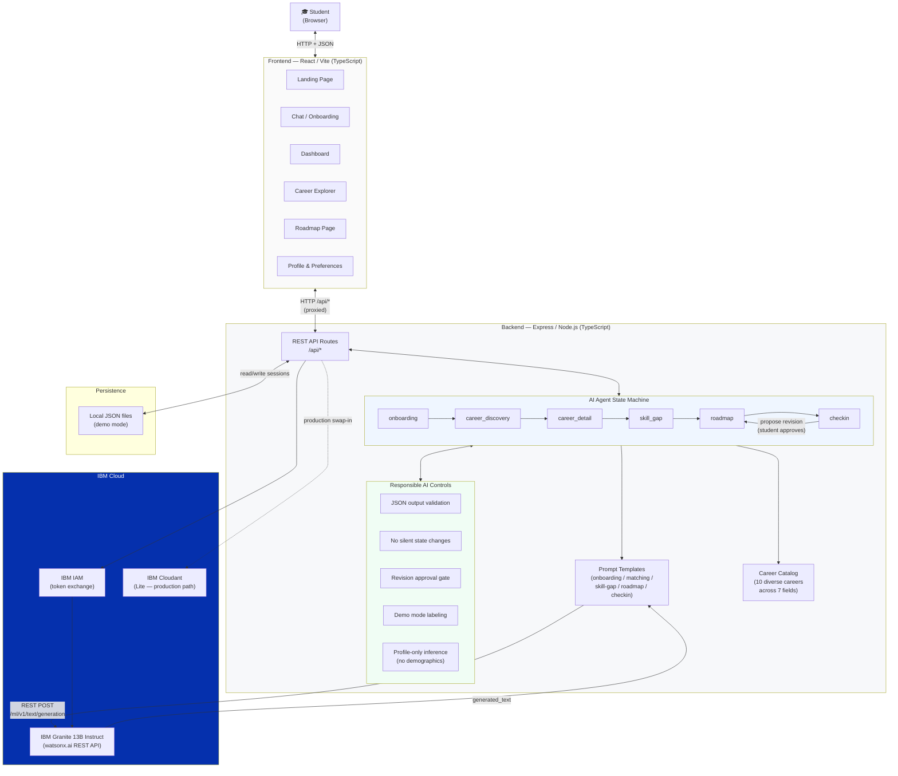
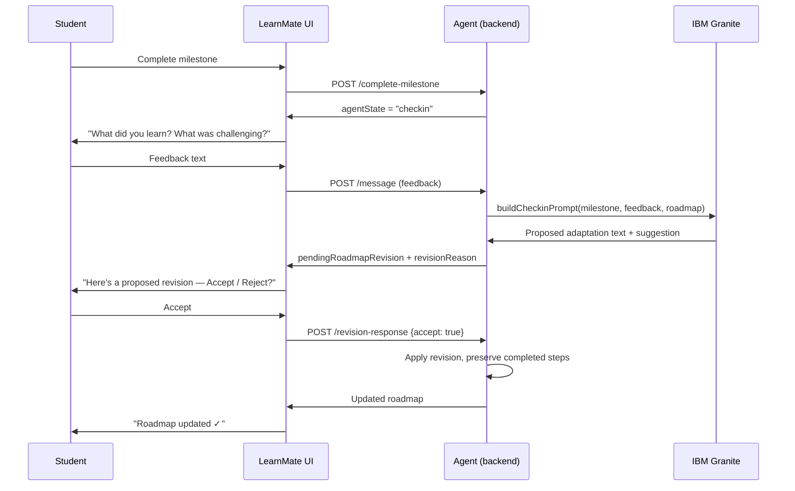

# LearnMate — Architecture Diagram

## System Architecture



## Progress Feedback Loop



## Data Model

```
StudentSession {
  id, createdAt, updatedAt
  agentState: AgentState         ← explicit workflow position
  profile: StudentProfile        ← interests, skills, goals, etc.
  conversation: Message[]        ← full history
  onboardingStep: number
  savedCareers: Career[]
  dismissedCareerIds: string[]
  selectedCareerId: string|null
  skillGap: SkillGap|null        ← existing vs. to-learn
  roadmap: Roadmap|null          ← current roadmap
  pendingRoadmapRevision: Roadmap|null  ← proposed, not yet applied
  revisionReason: string|null
}
```

## Responsible AI in the Architecture

| Layer | Control |
|---|---|
| **Prompt layer** | Prompts instruct Granite not to invent URLs/certifications; to explain reasoning; to state uncertainty |
| **Validation layer** | `extractJSON()` validates all structured Granite outputs before use; falls back to demo data on parse failure |
| **State machine** | No silent major decision changes; revision proposals require explicit student approval before `session.roadmap` is updated |
| **UI layer** | Every career card shows `fitReason`; demo mode banner always visible; responsible AI notices on roadmap and career pages |
| **Data layer** | Only profile fields needed for personalization are stored; no authentication data beyond session ID |
